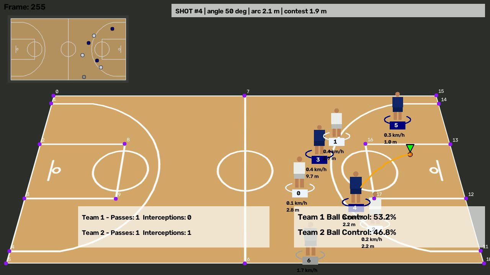

# NetVision: NBA Computer Vision Shot Tracker

NetVision turns basketball broadcast footage into tracking data and game stats. Give it a clip and it finds the players, the ball, and the court, follows every player through the clip, works out the teams from jersey colors, and measures what happened: ball possession, passes, interceptions, rebounds, distance and speed for each player, and a breakdown of every shot (release angle, arc height, and how closely it was defended).



*Annotated output on the synthetic test clip: team colored player IDs, ball holder, top-down tactical map, keypoints, running ball control and pass counts, and a shot breakdown with release angle, arc, and contest distance.*

## Features

| Area | What NetVision does |
|---|---|
| Detection | YOLO11 player, ball and rim detection (fine-tuned or stock COCO weights) |
| Tracking | ByteTrack multi-object tracking with stable player IDs |
| Ball cleaning | Rejects impossible jumps (25 px per missing frame) and fills short gaps by interpolation |
| Teams | Zero-shot CLIP jersey classifier (fashion-clip) or jersey color clustering, voted per track. Referees are flagged as team 0 |
| Possession | Containment and distance rules with an 11 frame confirmation, team ball control percentage |
| Events | Passes, interceptions, offensive and defensive rebounds |
| Court mapping | 18 court keypoints (YOLO pose model or a manual calibration file), geometric validation, homography to meters |
| Tactical view | Top-down mini map of every player |
| Movement | Distance covered (m) and speed (km/h) per player, with jitter smoothing |
| Shots | Shot detection from the ball's arc, release angle, arc apex height, flight time, contest distance, closest defender, distance to the basket, make or miss when a rim is detected |
| Outputs | Annotated video, `stats.json`, per frame `tracking.csv`, `events.csv` |
| Engineering | Two pass streaming (low memory), detection cache, YAML config, CLI, 102 tests with 98 percent coverage, GitHub Actions CI |

## How it works

```
             Pass 1: analyze                    Analysis (pure Python)                  Pass 2: render
video ──► YOLO players ─► ByteTrack ─┐     ball cleaning + interpolation          ┌─► drawers ─► annotated video
          YOLO ball / rim ───────────┼──►  team assignment (CLIP / colors)    ──► ┤
          court keypoints ───────────┤     possession ─► passes / interceptions   └─► stats.json, tracking.csv,
          jersey crops ──────────────┘     homography ─► court meters ─► speed            events.csv
                                           shot analyzer (arc, angle, contest)
```

The models only run in the first pass. Everything after that works on the stored detections, which is what makes the analysis easy to test and quick to rerun with `--use-stubs`.

## Quick start

```bash
git clone https://github.com/dmpindu/netvision.git
cd netvision
python -m venv .venv
# Windows: .venv\Scripts\activate     macOS/Linux: source .venv/bin/activate
pip install -r requirements-dev.txt
```

Check the install by running the test suite, which builds a synthetic clip with exact ground truth and runs the whole pipeline on it:

```bash
pytest
```

Then run NetVision on a real broadcast clip (the tutorial's sample clips are linked in [input_videos/README.md](input_videos/README.md)):

```bash
python -m netvision input_videos/video_1.mp4 --output-dir output
```

Useful flags: `--max-frames 100`, `--use-stubs` (cache detections), `--no-video`, `--device cuda`, `--team1-label "white shirt" --team2-label "dark blue shirt"`, `--config my.yaml`. Run `python -m netvision --help` for the full list.

## Models

NetVision looks in `models/` for fine-tuned weights and falls back to stock YOLO11 when they are missing (see [models/README.md](models/README.md)).

| File | Purpose |
|---|---|
| `models/player_detector.pt` | Players (the tutorial dataset also labels Hoop, which NetVision uses as the rim detector) |
| `models/ball_detector_model.pt` | Basketball |
| `models/court_keypoint_detector.pt` | 18 court keypoints (pose model) |
| `models/rim_detector.pt` | Optional separate rim model |

Stock COCO weights barely detect a basketball in broadcast footage, so for real games use fine-tuned weights. Train them on a free Colab GPU with [training/NetVision_Training_Colab.ipynb](training/NetVision_Training_Colab.ipynb), or from the command line:

```bash
export ROBOFLOW_API_KEY=...
python training/train.py player --epochs 100
python training/train.py ball --epochs 250 --imgsz 1280
python training/train.py court --epochs 300
```

For a fixed camera you can skip the court model and give four or more keypoints by hand in a JSON file (see [configs/court_calibration_example.json](configs/court_calibration_example.json)).

## Outputs

`<clip>_stats.json` (shortened):

```json
{
  "teams": {
    "2": {"possession_pct": 39.08, "passes": 1, "interceptions": 1, "shots": 1,
          "avg_release_angle_deg": 50.07, "avg_contest_distance_m": 1.901}
  },
  "shots": [{"shooter_id": 4, "team": 2, "release_frame": 240, "release_angle_deg": 50.07,
             "apex_height_m": 2.117, "contest_distance_m": 1.901, "closest_defender_id": 2,
             "distance_to_basket_m": 6.134, "result": "unknown"}]
}
```

`<clip>_tracking.csv` has one row per player per frame: `frame, time_s, track_id, team, x1, y1, x2, y2, court_x_m, court_y_m, speed_kmh, distance_m, has_ball`.

`<clip>_events.csv` lists passes, interceptions, rebounds and shots in order.

## Testing

```bash
pytest                                  # 99 tests, about 40 s on CPU
pytest --cov=netvision                  # 98 percent line coverage
pytest -m real_model                    # opt-in tests with real YOLO weights (see docs)
```

The end to end tests run the full pipeline on a generated clip with exact ground truth. On that clip NetVision finds every pass, interception, rebound and the shot, gets the release frame exactly, the release angle within 0.1 degrees, the arc height within 3 percent, contest distance within 0.1 m, and total distance within about 1 percent. Details are in [docs/03_Test_Plan_and_Results.md](docs/03_Test_Plan_and_Results.md).

## Project structure

```
netvision/
  config.py            all settings (YAML loadable)
  detection.py         YOLO detector, YOLO pose keypoints, manual calibration
  trackers/            ByteTrack player tracker, ball selection and cleaning
  team_assigner/       CLIP zero-shot and jersey color team classifiers
  possession/          ball acquisition (who has the ball)
  events/              passes, interceptions, rebounds
  court/               court geometry, keypoint validation, homography, top-down rendering
  metrics/             speed and distance, shot analytics, stats export
  drawers/             video overlays
  pipeline.py          two pass pipeline
  cli.py               command line entry point
  testing/synthetic.py synthetic clip with ground truth
training/              training script and Colab notebook
tests/                 pytest suite
docs/                  project scope, MVP, test plan and results
configs/               default config, calibration example
```

## Documentation

1. [Project Scope](docs/01_Project_Scope.md)
2. [Minimum Viable Product](docs/02_MVP.md)
3. [Test Plan and Results](docs/03_Test_Plan_and_Results.md)

## Roadmap

Phase 2 adds DeepSORT or BoT-SORT with re-identification and camera motion compensation, pose estimation on the shooter (release point, elbow angle, jump height), a dedicated rim model for make or miss, shot charts, and possession sequence export. Phase 3 is a web dashboard and batch processing.

## Credits

The architecture follows Abdullah Tarek's YOLO and OpenCV basketball analysis tutorial and uses the public Roboflow Universe datasets referenced there. Detection and training use Ultralytics YOLO, tracking uses Roboflow `trackers` and `supervision`, and the zero-shot team classifier uses `patrickjohncyh/fashion-clip` on Hugging Face.

## License

MIT, see [LICENSE](LICENSE).
